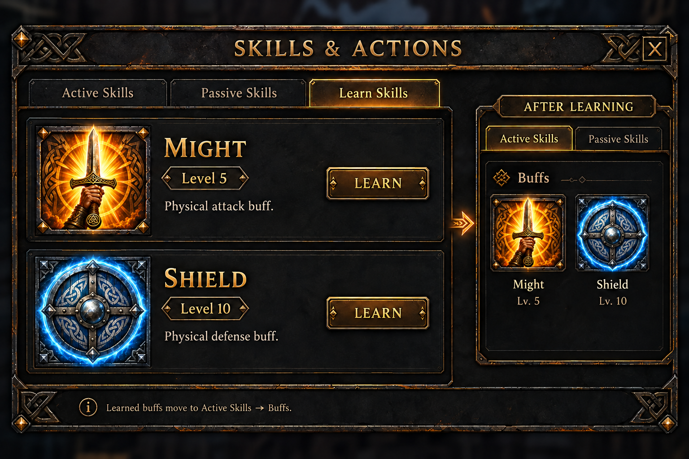

# Skills window concept

This is a visual proposal, not an in-game implementation. The Learn Skills tab shows the two Fighter buffs. Might strengthens physical attacks; Shield improves physical defense. The level 5 and level 10 gates shown in the image are provisional. Once learned, each buff leaves Learn Skills and appears under Active Skills → Buffs, using the same icon. The Learn button is disabled until the required level. A scrollbar appears only when the current tab has more entries than fit in its list.

The individual image assets are [Might](assets/might-buff-concept.png) and [Shield](assets/shield-buff-concept.png).

## Imagegen prompts

- Might: Square hand-painted fantasy buff icon, a raised steel sword against a radiant amber-gold flare, subtle Norse knotwork and dark weathered iron frame; readable at 48 × 48, no text.
- Shield: Companion square hand-painted fantasy buff icon, a steel and blue round Viking shield with an icy blue protective aura, subtle Norse knotwork and dark weathered iron frame; readable at 48 × 48, no text.
- Window: Front-on dark iron and charcoal fantasy Skills and Actions UI matching the inventory's thin antique-gold borders; Learn Skills selected with Might and Shield cards; a compact After Learning view shows the same icons under Active Skills → Buffs. The final image removes the scrollbar because only two skills are visible.

Generated with the built-in imagegen tool. Buff effect values, duration, costs, and learning requirements remain to be designed.
